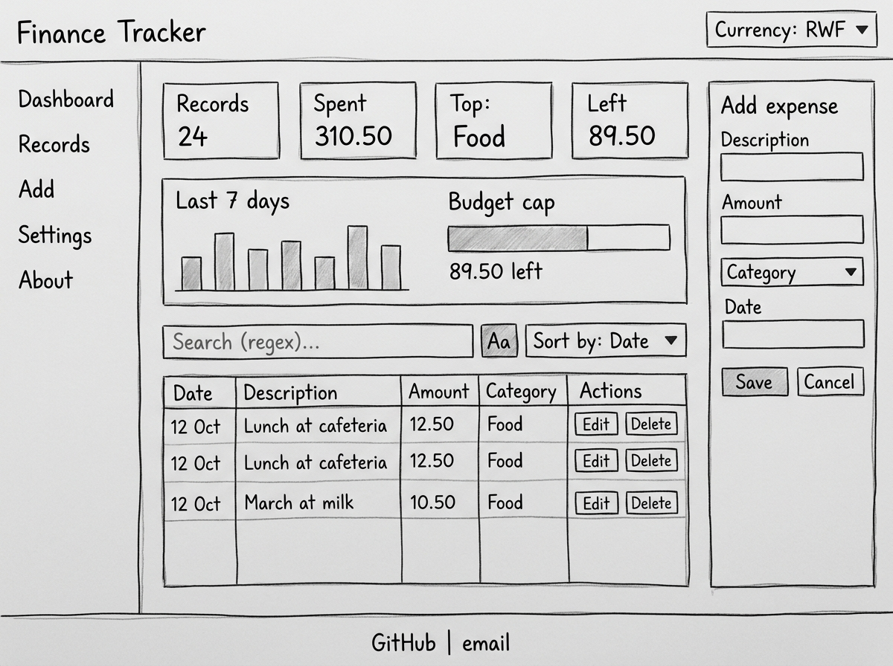

# Student Finance Tracker

A website for students to log spending, search it, and stay under budget.

**Live site:** (add your GitHub Pages link later)

## Planning (M1)

### Wireframes

Phone:


Tablet:


Laptop:


### Data model

Each expense is saved like this:

```json
{
  "id": "txn_0001",
  "description": "Lunch at cafeteria",
  "amount": 12.50,
  "category": "Food",
  "date": "2026-10-12",
  "createdAt": "2026-10-12T10:00:00Z",
  "updatedAt": "2026-10-12T10:00:00Z"
}
```

- `id`: unique, made by the app
- `amount`: stored in the base currency, up to 2 decimals
- `category`: Food, Books, Transport, Entertainment, Fees, Other (editable)
- `date`: YYYY-MM-DD

### Accessibility plan

- Skip-to-content link at the top of the page
- Proper landmarks: header, nav, main, section, footer
- Every input has a label; errors are linked to their field
- Visible focus outline on everything you can Tab to
- Status messages read out with `role="status"`; budget overage with `role="alert"`
- Text contrast of at least 4.5:1
- Everything works with the keyboard only (tested without a mouse)